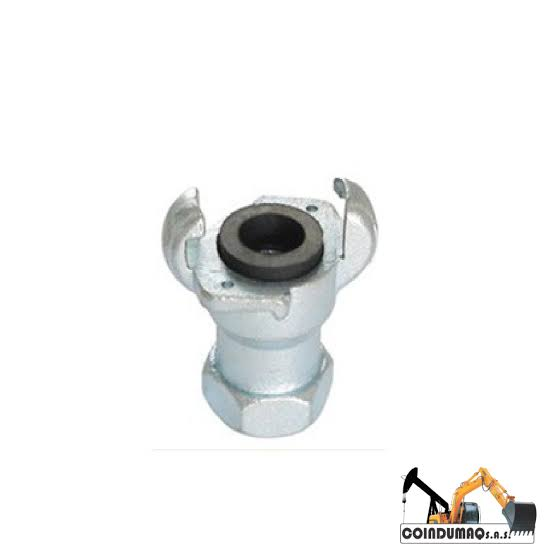

<link rel="stylesheet" href="./acople-chicago-hembra.css">

<article class="chicago-card" lang="es">
  <h1>Acople rápido tipo Chicago hembra</h1>
  <figure class="chicago-photo" aria-label="Acople visto de frente">
    

      
    

    

      
    

  </figure>
  

    <section><h2>Otros nombres</h2>
      <ul><li>Acople rápido tipo Dixon hembra</li><li>Acople de media vuelta hembra</li></ul>
    </section>
    <section><h2>Uso</h2>
Conecta una línea de aire comprimido a una herramienta o a otro tramo de manguera.
</section>
    <section><h2>Cómo reconocerlo</h2>
Tiene dos garras y un empaque de caucho en una cara. En el extremo hexagonal lleva la rosca interna.
</section>
    <section><h2>Medida</h2>
Se indica en pulgadas y corresponde a la rosca hembra. La foto sirve para las medidas con esta misma forma.
</section>
  

</article>
